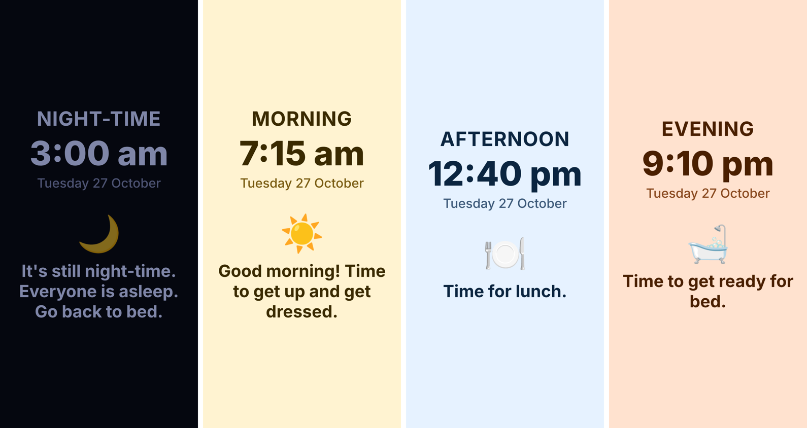
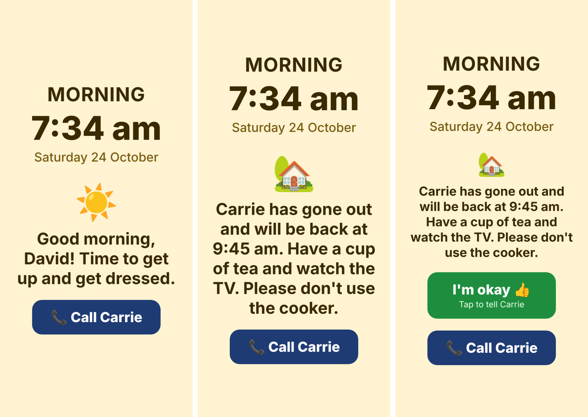
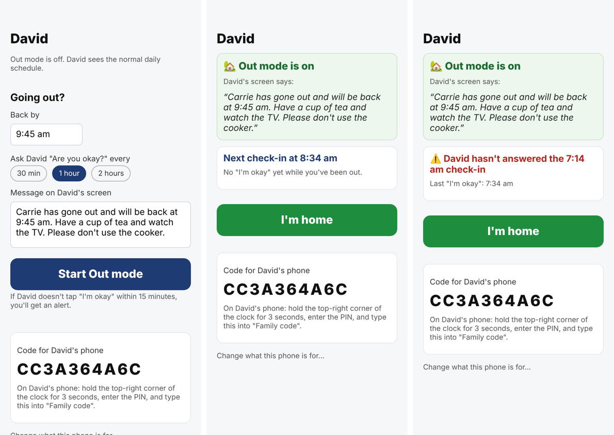

# DayGuide

A phone app for people living with dementia. It shows the time, the part of the
day, and one simple instruction for right now: "It's still night-time. Go back
to bed", "Time for lunch", "Time to get ready for bed". It runs on iPhone and
Android from one codebase (Expo / React Native).



## What it does

- **Big, calm clock screen.** Shows the time, MORNING / AFTERNOON / EVENING / NIGHT-TIME,
  the day and date, an icon and the current message. Colours change through the day;
  night is dark and dim.
- **Daily schedule set by family.** Each entry has a time, message, icon and
  mode. A message shows from its time until the next one. Use `{name}` in a
  message to insert his name.
- **Reminder sounds during the day, silence at night.** Day entries can play a
  reminder notification at their time. Night entries never make a sound.
- **Screen stays on during the day** while the app is open, and is allowed to
  switch off at night.
- **Hidden family settings.** Hold the clock time (the big numbers) for 3
  seconds, then enter the 4-digit PIN (default `1234`; change it in settings).
- **Call button.** A big "📞 Call Carrie" button on the clock (hidden at night
  unless Out mode is on).

## Family features: Out mode and check-ins

On first launch each phone is set up either for the person being cared for
(David) or for a family member (Carrie). Carrie's app shows a 6-digit link
code (single use, lasts 15 minutes), which is typed into the top of David's
settings to link the two phones. It is separate from the settings PIN.

- **Out mode.** Before going out, Carrie sets when she'll be back and how often
  to check in. David's screen then shows her message instead of the schedule,
  e.g. "Carrie has gone out and will be back at 3:00 pm. Have a cup of tea and
  watch the TV. Please don't use the cooker."
- **Check-ins.** When a check-in is due, David's phone asks "Are you okay,
  David?" and shows a big green "I'm okay" button. Carrie gets "David is
  okay ✓" when he taps it.
- **Missed check-in alert.** If he hasn't tapped within 15 minutes, Carrie gets
  an alert so she can call.
- **I'm home.** One tap ends Out mode and David's normal schedule returns.




### Setting up the server (one-off)

The family features use a Supabase project. Without one, the app still works
on its own; the family features are just hidden.

1. Create a Supabase project. In **Database → Extensions**, turn on `pg_cron`
   and `pg_net`.
2. In the **SQL Editor**, run
   [`supabase/migrations/0001_dayguide_family.sql`](supabase/migrations/0001_dayguide_family.sql),
   then [`0002_patient_seen.sql`](supabase/migrations/0002_patient_seen.sql)
   (lets the family member see whether the cared-for phone is connected) and
   [`0003_link_codes.sql`](supabase/migrations/0003_link_codes.sql)
   (6-digit link codes).
3. Put the project URL and the anon or publishable key (from **Project
   Settings → API Keys**) in `eas.json` for app builds, and in `.env` (copy
   `.env.example`) for running locally. Both are public values that ship
   inside the app.
4. Push notifications need an EAS project: run `npx eas-cli@latest init` once.
   Push notifications only work in a real build, not in a web browser.

## Try it

```
npm install
npx expo start
```

Scan the QR code with the Expo Go app on an iPhone or Android phone, or press
`w` to open it in a browser (reminders don't fire in the browser).

For real use, build an installable app with EAS:
`npx eas-cli@latest build --platform all`.

## Not built yet

- Lock-screen / home-screen widget, so the message is visible without opening
  the app (needs native widget code per platform).
- Editing David's daily schedule from Carrie's phone.
- Alerts to more than one family member (today only the most recent family
  phone to open the app gets them).
- Quiet alert to a carer's phone when he's using the phone at night.
- Alert if the phone leaves home.
- Recorded voice messages in a family member's voice.
- Stronger security before selling: the family code is the only key to a
  household, so proper accounts should replace it.
